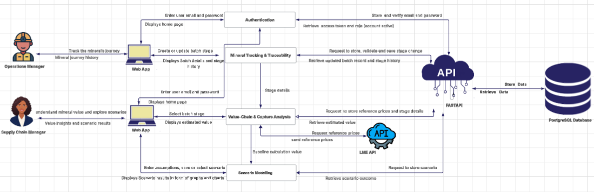
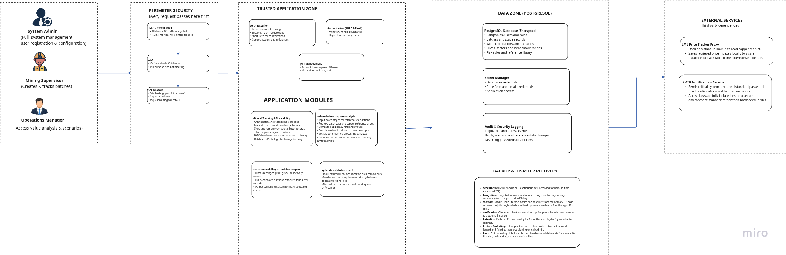

# Architecture Overview

## System Architecture Diagram



RICA uses a client-server architecture. The web dashboard communicates with the RICA backend through APIs, while the backend handles communication with the PostgreSQL database.

The RICA platform consists of:

- RICA Web Dashboard
- RICA Backend API
- PostgreSQL Database
- RICA Informational Website

The web dashboard is used by authorized users (Operations Managers, Supply Chain Managers, and System Administrators) to manage batches, track value calculations, and monitor traceability across the supply chain.

## System Components

### 1.1 Web Dashboard
The RICA web dashboard provides role-specific functionality for different user types.

The dashboard communicates with the backend through the API and includes functionality such as:

- User authentication and authorization
- Batch management
- Processing stage tracking
- Value calculations
- QR code generation and scanning
- Traceability views
- User management (System Administrators)
- Company-level scoping

The web dashboard does not connect directly to the PostgreSQL database. Data is exchanged through the backend API.

### 1.2 Backend API
The RICA backend is built with FastAPI and provides the API layer for the web dashboard.

The backend handles:

- API requests
- Authentication and authorization (JWT with blacklisting)
- User and role management
- Mineral batch management
- Processing stage management
- Value calculations based on LME pricing
- QR code generation
- Audit logging
- Database operations
- Security and request handling

The backend communicates with PostgreSQL for persistent data storage. Detailed backend structure and API functionality are documented in [Backend API Specifications](../backend/backend-api-spec.md).

### 1.3 PostgreSQL Database
RICA uses PostgreSQL for persistent data storage.

The database contains information used by the platform, including:

- Users and roles
- Companies
- Mineral batches
- Processing stages
- Batch history
- Value calculations
- Prices
- Audit logs
- MFA/TOTP data

The backend is responsible for database access. The web dashboard does not access PostgreSQL directly. More information is available in [Database Schemas](database-schemas.md).

### 1.4 Informational Website
The RICA informational website is the public-facing website for the project.

It provides information about RICA, its purpose, and the services provided by the platform. The informational website is separate from the authenticated web dashboard.

[Visit the RICA Informational Website](https://heliks-informational-website.vercel.app)

> Note: Bloom was a separate app concept; RICA is the current copper traceability platform focused on mineral batch tracking, processing stages, and value calculations.

## How the Components Connect

The main communication path within RICA is:

```
RICA Web Dashboard
          │
          │ API requests
     RICA Backend API
          │
          │ Database operations
        PostgreSQL
```

The informational website is publicly accessible and operates separately from the authenticated web dashboard.

## Secure System Architecture Diagram



The diagram above illustrates the secure architecture of the RICA platform, showing the interaction between components, security boundaries, and data flow. 

## Backend Architecture

The backend is organized into separate areas for API routes, application logic, data access, schemas, and database models.

At a high level:

```
API Request
    │
  Router
    │
  Service
    │
Repository / Database
    │
PostgreSQL
```

This structure keeps the API routes separate from the application logic and database access. The backend also contains shared functionality for configuration, security, authentication, audit logging, and dependencies. The complete backend structure is documented in [Backend API Specifications](../backend/backend-api-spec.md).

## Dashboard API Integration

The RICA web dashboard communicates with the RICA backend through the API. The API supports dashboard functionality including:

- Administrator and role-based authentication
- User management
- Batch and stage management
- Value calculations and pricing
- Traceability and QR code operations
- Audit logs
- Account settings

The dashboard does not access the database directly. Further details are available in [Frontend App Architecture](../frontend/frontend-app-architecture.md).

## User Data Flow

For authenticated users:

```
User (Ops/Supply Chain/Admin)
            │
        Web Dashboard
            │
          RICA API
            │
          PostgreSQL
```

This provides a single backend layer through which application data is processed and stored with company-level scoping and role-based access control.

## Architecture Principles

- **Separation of Responsibilities**: The web dashboard, backend, and database each have their own responsibilities.
- **Centralized API**: The web dashboard communicates with the backend through APIs rather than connecting directly to the database.
- **Role-Based Access**: RICA provides different functionality for Operations Managers, Supply Chain Managers, and System Administrators.
- **Company-Level Scoping**: Data access is restricted based on the user's company.
- **Centralized Data Storage**: Application data is stored in PostgreSQL and accessed through the backend.
- **Modular Backend**: The backend separates routers, services, repositories, schemas, and models so that different parts of the application can be maintained independently.
- **Audit Trail**: All critical actions are logged for traceability and compliance.
