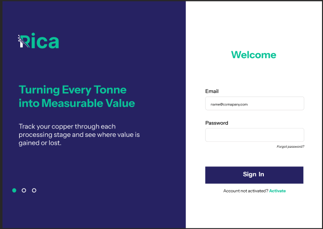
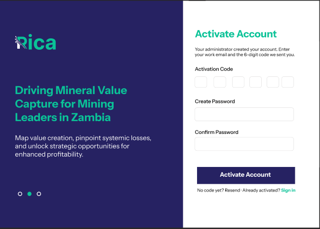
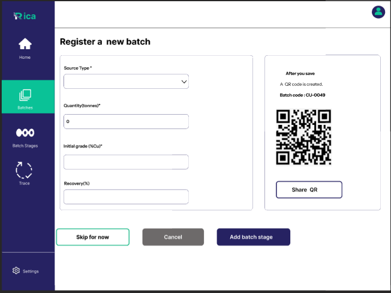
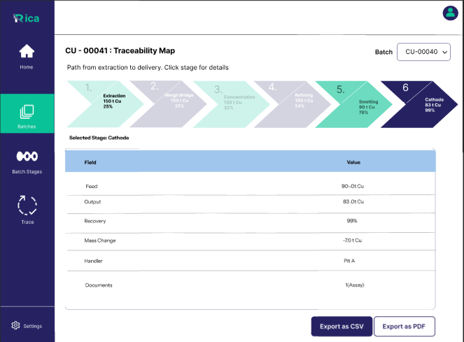
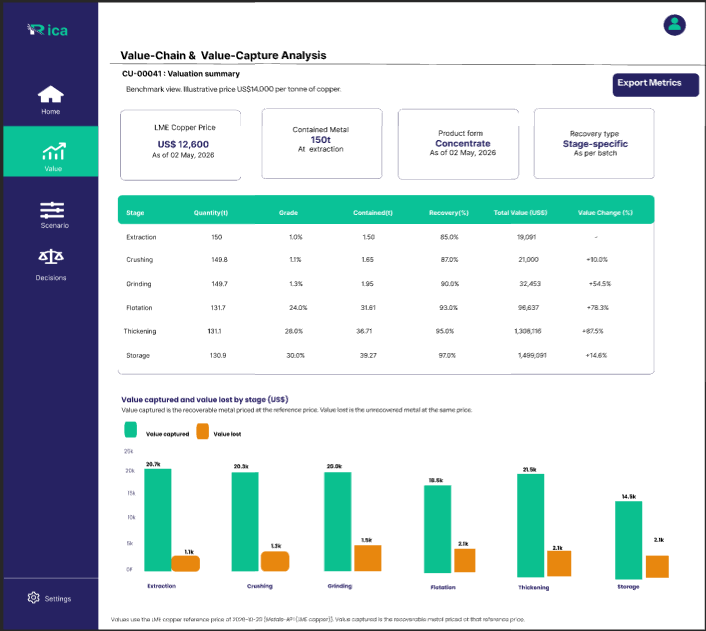
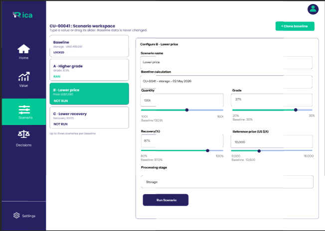

---
hide:
  - title
---

    

    <a href="developer-guide/backend-setup/" style="background: linear-gradient(135deg, #262262, #1a194a); color: white !important; font-weight: 600; padding: 0.8rem 2rem; border-radius: 8px; text-decoration: none !important; margin: 0.5rem; display: inline-block;">Learn More</a>
    <a href="architecture/system-context/" style="background: #0BC08F; color: white !important; font-weight: 600; padding: 0.8rem 2rem; border-radius: 8px; text-decoration: none !important; margin: 0.5rem; display: inline-block;">Get Started</a>

## About RICA

RICA provides end-to-end traceability from extraction through processing stages, maintaining an immutable audit trail of all batch movements. The platform enforces strict data validation, role-based access control, and company-level scoping to ensure data integrity and security across multi-tenant operations.

    <a href="https://heliks-informational-website.vercel.app" target="_blank" style="background: #fff; color: #262262 !important; font-weight: 600; padding: 0.7rem 1.8rem; border-radius: 8px; text-decoration: none !important; display: inline-block; border: 2px solid #262262;">More about RICA</a>

## System Architecture

    <h3 style="margin-top: 0; color: #262262;">Backend Engine</h3>
    
FastAPI service with SQLAlchemy ORM, PostgreSQL database, JWT authentication, and automated value calculations using live LME pricing.

    <h3 style="margin-top: 0; color: #262262;">Web Dashboard</h3>
    
Next.js 16 application with role-based interfaces for operations managers, supply chain managers, and system administrators.

    <h3 style="margin-top: 0; color: #262262;">Marketing Portal</h3>
    
Informational website showcasing the platform capabilities with optimized single-page navigation.

## App Preview

## Project Team

    

    

        
    

    
Samantha Linda

    
Software Engineer

    

        
    

    
Mailisha Awuor

    
Software Engineer

    

        
    

    
Rose Wanjiru

    
Software Engineer

    

        
    

    
Eyerusalem Gabremedhin

    
Software Engineer

    

        
    

    
Salvatrice Igabineza

    
Software Engineer

    

        

            
✉

            

                
Email

                <a href="mailto:heliks@gmail.com" style="font-weight: 600; text-decoration: none; color: inherit;">heliks@gmail.com</a>
            

        

        

            
☎

            

                
Contact

                
+254789101213

            

        

        

            

                <svg width="20" height="20" viewBox="0 0 24 24" fill="none" stroke="white" stroke-width="2" stroke-linecap="round" stroke-linejoin="round"><path d="M21 10c0 7-9 13-9 13s-9-6-9-13a9 9 0 0 1 18 0z"></path><circle cx="12" cy="10" r="3"></circle></svg>
            

            

                
Location

                
616- Korongo Road

            

        

        

            

                <svg width="20" height="20" viewBox="0 0 24 24" fill="none" stroke="white" stroke-width="2" stroke-linecap="round" stroke-linejoin="round"><rect x="2" y="2" width="20" height="20" rx="5" ry="5"></rect><path d="M16 11.37A4 4 0 1 1 12.63 8 4 4 0 0 1 16 11.37z"></path><line x1="17.5" y1="6.5" x2="17.51" y2="6.5"></line></svg>
            

            

                
Instagram

                
heliks_developers

            

        

    

